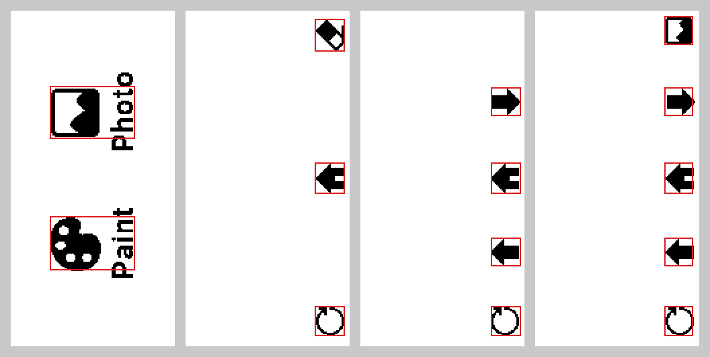
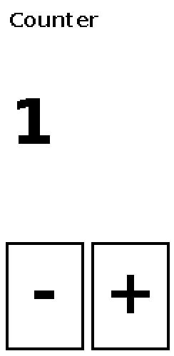

# Understanding Waveshare's 2.13" Touch e-Paper example

This tutorial takes apart Waveshare's official example for the 2.13" Touch e-Paper HAT (V4),
piece by piece, and then puts the pieces back together into a small app of your own.

1. [Before you start](#0-before-you-start)
2. [The hardware in one picture](#1-the-hardware-in-one-picture)
3. [The display: init, draw, refresh](#2-the-display-init-draw-refresh)
4. [The structure of the official example](#3-the-structure-of-the-official-example)
5. [Touch](#4-touch)
6. [Putting it together: your own app](#5-putting-it-together-your-own-app)
7. [Where to go next](#6-where-to-go-next) and [exercises](#exercises)

Every part has a small program in [`examples/`](examples/) that you can run on the Pi:

| Program | What it shows |
|---|---|
| `examples/01_hello.py` | init, draw, full refresh, sleep |
| `examples/02_partial_counter.py` | partial refresh, and a full refresh every so often |
| `examples/03_touch_print.py` | reading the touch controller |
| `examples/04_tap_counter.py` | everything together: buttons, taps, refreshes, clean exit |

They were checked on a laptop against a fake driver that records every call (no panel), so
the logic and the drawing are tested; run them on the HAT to see the real panel.

Where the official files are, in Waveshare's repository
[Touch_e-Paper_HAT](https://github.com/waveshareteam/Touch_e-Paper_HAT):

| File | What it is |
|---|---|
| `python/examples/TP2in13_V4_test.py` | the example: a menu, a paint page and a photo viewer |
| `python/lib/TP_lib/epd2in13_V4.py` | display driver |
| `python/lib/TP_lib/gt1151.py` | touch driver |
| `python/lib/TP_lib/epdconfig.py` | the pins, SPI and I2C |
| `python/pic/2in13/*.bmp` | the example's screens and photos |

This folder has a copy of the three drivers in `TP_lib/` (the only change: `gt1151.py` logs
instead of printing). Line numbers in this tutorial refer to Waveshare's repository.

---

## 0. Before you start

```bash
sudo raspi-config nonint do_spi 0      # SPI on (the display)
sudo raspi-config nonint do_i2c 0      # I2C on (the touch controller)
sudo reboot
sudo apt install python3-gpiozero python3-lgpio python3-spidev python3-smbus \
                 python3-numpy python3-pil fonts-dejavu-core
```

Run the official example once, to see what we are taking apart:

```bash
cd Touch_e-Paper_HAT/python/examples
python3 TP2in13_V4_test.py             # Ctrl+C to stop
```

Waveshare's readme says `sudo`; a user in the `spi`, `i2c` and `gpio` groups (the default
user on Raspberry Pi OS usually is) does not need it.

**Only one program can use the HAT at a time.** If the status display from this folder runs as
a service, stop it first: `sudo systemctl stop epaper-stats`.

## 1. The hardware in one picture

```
 Raspberry Pi                        Touch e-Paper HAT
 ─────────────                       ─────────────────────────────────────
 SPI0  MOSI, SCLK, CE0 (GPIO 8) ───► display controller   250 x 122 pixels, black/white
       GPIO 25  DC   (out) ────────► "this byte is a command / data"
       GPIO 17  RST  (out) ────────► display reset
       GPIO 24  BUSY (in)  ◄──────── "still refreshing"
 I2C1  SDA, SCL ◄──────────────────► touch controller GT1151, address 0x14
       GPIO 22  TRST (out) ────────► touch reset
       GPIO 27  INT  (in)  ◄──────── "I have a new touch report"
```

The pin numbers are in `epdconfig.py` (lines 37–45). Two things to know about that file:

- **Importing it claims the hardware.** It opens SPI and I2C and takes the pins the moment any
  driver is imported (lines 47–60). If SPI or I2C is off, the import itself fails; if another
  program holds the pins, you get an error that a pin is busy.
- **`EPD()` sets the touch controller's I2C address** (`epd2in13_V4.py` line 49). Create the
  display object first, even in a program that only reads touches.

## 2. The display: init, draw, refresh

### 2.1 The calls

| Call | What it does | Waits until done |
|---|---|---|
| `epd = epd2in13_V4.EPD()` | creates the driver object; no hardware access yet | |
| `epd.init(epd.FULL_UPDATE)` | hardware reset, software reset, full setup | yes |
| `epd.init(epd.PART_UPDATE)` | short reset and the settings for partial refresh | |
| `epd.Clear(0xFF)` | fills the screen white with a full refresh | yes |
| `epd.getbuffer(image)` | turns a Pillow image into the bytes the panel takes | |
| `epd.display(buf)` | full refresh | yes |
| `epd.displayPartBaseImage(buf)` | full refresh that also stores the picture as the **base** for partial refreshes | yes |
| `epd.displayPartial_Wait(buf)` | partial refresh | yes |
| `epd.displayPartial(buf)` | partial refresh that returns **before** the panel is done | no |
| `epd.sleep()` | deep sleep (then waits 2 s) | yes |
| `epd.Dev_exit()` | releases SPI, I2C and the pins | |

"Waits until done" means the call watches the BUSY pin (`ReadBusy`, lines 98–102) and returns
only when the panel has finished.

### 2.2 Pictures

You never send text or shapes to the panel. You draw a whole picture with Pillow and send all
of it:

```python
from PIL import Image, ImageDraw, ImageFont
image = Image.new("1", (250, 122), 255)        # mode "1": black and white; 255 = white
draw = ImageDraw.Draw(image)
draw.text((10, 40), "Hello", font=ImageFont.truetype(
    "/usr/share/fonts/truetype/dejavu/DejaVuSans.ttf", 24), fill=0)     # 0 = black
buf = epd.getbuffer(image)
```

`getbuffer` (lines 230–244) accepts two sizes:

- **122 × 250, portrait**, the panel's own shape. It is turned 180°.
- **250 × 122, landscape.** It is turned 270°.

Any other size gives a warning and a black buffer, so the screen goes black. The official
example works in portrait: all its `.bmp` screens are 122 × 250.

### 2.3 Full refresh

A full refresh drives every pixel black and white a few times before showing the new picture.
It flashes and takes a couple of seconds, and it leaves the screen clean.

[`examples/01_hello.py`](examples/01_hello.py) is the smallest complete program:

```python
epd = epd2in13_V4.EPD()
epd.init(epd.FULL_UPDATE)
epd.Clear(0xFF)
image = Image.new("1", (epd.height, epd.width), 255)       # 250 x 122
...draw...
epd.display(epd.getbuffer(image))
epd.sleep()
epd.Dev_exit()
```

Note `(epd.height, epd.width)`: the driver's `width` is 122 and `height` 250 (portrait), so a
landscape image is `(height, width)`.

### 2.4 Partial refresh and the base image

A partial refresh changes only the pixels that differ from the previous picture. It is fast
and does not flash, but it leaves faint shadows of old pictures ("ghosting"). Three rules:

1. **It still sends the whole screen.** "Partial" is the quick way of changing pixels, not a
   region: `displayPartial` always writes the full 122 × 250 frame (lines 286–290).
2. **It needs a base.** The panel compares the new picture with the old one. After a full
   refresh, call `displayPartBaseImage` (it writes the picture into both of the controller's
   picture memories, lines 327–335), then `init(PART_UPDATE)`.
3. **Every so often, refresh fully.** The official example does a full refresh after 50
   partial ones; [`examples/02_partial_counter.py`](examples/02_partial_counter.py) does one
   every 10:

```python
def full(buf):
    epd.init(epd.FULL_UPDATE)
    epd.displayPartBaseImage(buf)
    epd.init(epd.PART_UPDATE)

full(picture(0))
for n in range(1, 31):
    time.sleep(1)
    if n % 10 == 0:
        full(picture(n))                  # flashes; ghosting gone
    else:
        epd.displayPartial_Wait(picture(n))
```

**`displayPartial` versus `displayPartial_Wait`.** The first returns without waiting for the
panel. The next call starts with a hardware reset pulse, possibly while the panel is still
updating. The official example uses it only on its paint page, where speed matters more than a
perfect picture. Use `displayPartial_Wait` unless you have a reason not to.

### 2.5 Sleep and exit

The panel keeps its picture without power. `sleep()` puts the controller into deep sleep; to
use it again, call `init(epd.FULL_UPDATE)` (it starts with a hardware reset). `Dev_exit()`
releases the pins, so call it last. Because the picture stays on the glass, a program that
stopped looks exactly like one that is still running: show a time or a "stopped" screen.

### 2.6 Under the hood (optional)

The driver talks to the display controller with two functions:

```python
def send_command(self, command):      # DC low: this byte is a command
def send_data(self, data):            # DC high: this byte is data for the last command
```

`init`, `display` and friends are sequences of these. A few commands you will see:

| Command | Meaning |
|---|---|
| `0x12` | software reset |
| `0x24` | write the new picture into memory |
| `0x26` | write the "old" picture (the base for partial refreshes) |
| `0x22` then `0x20` | choose the refresh type (`0xF7` full, `0xFF` partial), then start it |
| `0x10` | deep sleep |

`Clear` and `displayPartBaseImage` send one byte per call: 4000 calls per picture, and
`displayPartBaseImage` sends the picture twice. `display` and the partial calls send the
whole picture in one go (`send_data2`). That is why the first two are noticeably slower.

## 3. The structure of the official example

Open `python/examples/TP2in13_V4_test.py` next to this section.



*Its four screens (`Menu`, `White_board`, `Photo_1`, `Photo_2`), with the touch boxes from the
code drawn in red. The screens are drawn sideways: you hold the panel in landscape, but the
pictures are stored in portrait, the same coordinates the touch controller reports.*

### 3.1 Setup (lines 1–88)

| Lines | What happens |
|---|---|
| 5–9 | find `pic/` and `lib/` relative to the script, add `lib/` to the import path |
| 11–12 | import the touch and display drivers (this claims the hardware, section 1) |
| 22–29 | `pthread_irq`, the touch thread (section 3.2) |
| 31–50 | helpers that paste photos and screens into `image` |
| 55–58 | create the display, the touch controller and two `GT_Development` objects (section 4.2) |
| 62–64 | `epd.init(FULL_UPDATE)`, `gt.GT_Init()`, `epd.Clear(0xFF)` |
| 66–68 | start the touch thread |
| 74–77 | open `Menu.bmp`, show it with `displayPartBaseImage`, switch to `PART_UPDATE` |
| 79 | the state: `Page` and the counters `i`, `j`, `k`, `ReFlag`, `SelfFlag` |

### 3.2 The touch thread (lines 22–29)

```python
def pthread_irq():
    while flag_t == 1:
        if gt.digital_read(gt.INT) == 0:
            GT_Dev.Touch = 1
        else:
            GT_Dev.Touch = 0
```

It copies the INT pin into `GT_Dev.Touch`, as fast as it can, forever. There is no `sleep`, so
this thread keeps the CPU busy all the time.

### 3.3 The main loop: when to refresh (lines 90–115)

Each pass of `while(1)` first decides whether to refresh:

| Condition | Refresh | Why |
|---|---|---|
| `i > 12` or `ReFlag == 1` | partial (`displayPartial` on the paint page, else `_Wait`) | 12 touch reports drawn, or a page changed |
| `k > 50000` and `i > 0` on the paint page | partial | something was drawn, then nothing for a while |
| `j > 50` or `SelfFlag` | full (`init FULL`, `displayPartBaseImage`, `init PART`) | 50 partial refreshes, or the refresh button |

- `i` counts touch reports since the last refresh.
- `j` counts partial refreshes.
- `k` counts loop passes, so "a while" depends on how fast the Pi is.

Then it reads the touch controller (line 117, section 4) and skips the rest when the report is
the same as the last one (lines 118–119).

### 3.4 Pages: a state machine in disguise (lines 121–224)

`Page` is the state. Each block checks whether the touch falls inside a box and, if so,
changes `Page`, pastes new pictures into `image` and sets `ReFlag = 1` so the next pass
refreshes.

| Page | Screen | Touch boxes (x, y ranges) → what happens |
|---|---|---|
| 0 | menu | Photo (29–92, 56–95) → page 2; Paint (29–92, 153–193) → page 1 |
| 1 | paint | every touch draws a square; eraser (96–118, 6–30) → blank page; back (96–118, 113–136) → menu; refresh (96–118, 220–242) → full refresh |
| 2 | photo grid | next (97–119, 57–78); back to menu (113–136); previous (169–190); refresh (220–242); a photo (2–90, 2–248) → page 3 |
| 3 | one photo | grid (96–117, 4–25) → page 2; next (57–78); menu (113–136); previous (169–190); refresh (220–242) |

Two things to notice:

- **The touch boxes are small.** Most are 22 × 22 pixels, about 4 mm, while a fingertip is
  8–10 mm.
- **On the paint page the printed messages are swapped.** The eraser prints "Home ..." and the
  back arrow prints "Clear ...", but what they *do* matches the icons. It shows how easily
  labels and behaviour drift apart when both are spread over long `if` chains.

### 3.5 Exit (lines 226–235)

Only Ctrl+C (`KeyboardInterrupt`) cleans up: stop the thread, `epd.sleep()`, `Dev_exit()`. An
I/O error just logs and ends. `systemctl stop` sends SIGTERM, which this code does not catch,
so as a service the panel is never put to sleep.

### 3.6 What to keep, what to change

| Keep | Change |
|---|---|
| draw into a Pillow image, send the whole picture | add a `sleep` to every loop (both loops here never sleep) |
| `displayPartBaseImage` after a full refresh, then partial refreshes | turn touch reports into taps (section 4.3) instead of reacting to every report |
| a full refresh every N partial ones | make touch boxes finger-sized |
| one `Page` variable deciding what touches mean | keep each page's boxes and actions in one place (a table or a function) |
| sleep and `Dev_exit` on the way out | catch SIGTERM too, so it also cleans up as a service |

## 4. Touch

### 4.1 What the touch controller sends

The GT1151 does not send taps or clicks. While a finger is on the glass it produces
**reports**, many per second, and pulls INT low when one is ready. The driver (`gt1151.py`)
reads them over I2C:

| Call | What it does |
|---|---|
| `gt = gt1151.GT1151()` | the driver object (pins from `epdconfig.py`) |
| `gt.GT_Init()` | resets the controller (TRST high, low, high, 100 ms each), reads its version from register `0x8140` |
| `gt.digital_read(gt.INT)` | the INT pin: 0 = a report is waiting |
| `gt.GT_Scan(dev, old)` | reads one report into `dev` (and the previous point into `old`) |

### 4.2 `GT_Scan` step by step (lines 50–83)

```
only if dev.Touch == 1 (you set it when INT was low), then dev.Touch = 0:
  read register 0x814E (status)
    bit 7 = 0          → no report ready: write 0 to 0x814E, wait 10 ms, done
    bit 7 = 1          → dev.TouchpointFlag = 0x80
    bits 0-3           → dev.TouchCount = number of fingers (1 to 5)
    count not 1 to 5   → write 0 to 0x814E, done (dev.TouchpointFlag stays set!)
  read count × 8 bytes from 0x814F, write 0 to 0x814E ("I have read it")
  copy dev's first point into old
  for each finger i: dev.X[i], dev.Y[i] = position, dev.S[i] = contact size
```

`GT_Development` is just a holder for these fields. You read them and set `TouchpointFlag` back
to 0 yourself once you have handled a report.

[`examples/03_touch_print.py`](examples/03_touch_print.py) prints every report:

```python
epd = epd2in13_V4.EPD()            # first: sets the touch I2C address
gt = gt1151.GT1151()
dev, old = gt1151.GT_Development(), gt1151.GT_Development()
gt.GT_Init()
while True:
    if gt.digital_read(gt.INT) == 0:
        dev.Touch = 1
        gt.GT_Scan(dev, old)
        if dev.TouchpointFlag:
            dev.TouchpointFlag = 0
            if 1 <= dev.TouchCount <= 5:
                print(dev.X[0], dev.Y[0], dev.S[0], dev.TouchCount)
    time.sleep(0.01)
```

The real file also lets the GPIO library catch the moment INT goes low
(`epdconfig.GPIO_INT.when_released`). Waveshare's demo watches the pin level in a loop that never
sleeps; with a 10 ms sleep, a short pulse could otherwise fall between two checks.

### 4.3 Reports are not taps

Run example 3 and rest a finger on the glass: one touch prints line after line. If your
program does something on every report, one tap does it many times. Decide what a tap is, for
example "the first report after 0.2 s without reports". The official example has no such rule;
on the paint page that is fine (every report draws), on buttons it is not.

### 4.4 Coordinates

The official example draws touches straight onto its 122 × 250 portrait picture (paint page,
line 140), and its touch boxes sit on the icons of its portrait screens (the picture in
section 3). So **touch coordinates are portrait image pixels**: x from 0 to 121 across the
short side, y from 0 to 249 along the long side.

If you draw in landscape (250 × 122), turn each touch point the same way `getbuffer` turns
the picture. From its two rotations (portrait 180°, landscape 270°) that works out to:

```python
landscape_x = 249 - touch_y
landscape_y = touch_x
```

This is derived from the code, not measured. Check it on your panel: run example 3, tap the
four corners of the screen held in landscape, and compare.

### 4.5 Hit testing

A button is a rectangle and a test:

```python
PLUS = (64, 170, 118, 245)                       # x0, y0, x1, y1

def inside(box, x, y):
    return box[0] <= x <= box[2] and box[1] <= y <= box[3]
```

Make the rectangle about the size of a fingertip: on this panel one pixel is about 0.19 mm,
so 8–10 mm is 40–50 pixels. The touch area may be larger than what you draw (see the README,
section 5).

## 5. Putting it together: your own app

[`examples/04_tap_counter.py`](examples/04_tap_counter.py) is a counter with "−" and "+"
buttons. It is portrait, like the official example, so touch points need no conversion.



Its parts, in the order of the file:

**1. Constants and a render function.** Data in, picture out; no hardware:

```python
MINUS = (4, 170, 58, 245)
PLUS = (64, 170, 118, 245)

def render(count):
    image = Image.new("1", (122, 250), 255)
    ...draw the title, the number and both buttons...
    return image
```

**2. Clean exit.** SIGTERM (`systemctl stop`) and SIGINT (Ctrl+C) only set a flag; the loop
ends and the `finally` block puts the panel to sleep:

```python
signal.signal(signal.SIGTERM, stop)
signal.signal(signal.SIGINT, stop)
```

**3. Setup.** The same order as the official example, without the thread:

```python
epd = epd2in13_V4.EPD()
gt = gt1151.GT1151()
epd.init(epd.FULL_UPDATE)
gt.GT_Init()
epd.displayPartBaseImage(epd.getbuffer(render(count)))
epd.init(epd.PART_UPDATE)
```

**4. The loop**, in four steps, then a 10 ms sleep:

```python
while running:
    # 1. read a report when the controller has one
    # 2. turn reports into taps: only the first report after 0.2 s of silence counts
    # 3. hit test: what did the tap mean?
    # 4. redraw only when something changed: partial, or full every 20th time
    time.sleep(0.01)
```

After each refresh it sets `last_report` to the current time, so a finger still resting on
the glass does not count as a new tap.

Compared to the official example:
- no thread
- no busy loops
- taps instead of raw reports
- finger-sized buttons
- refreshes only on change
- cleanup on SIGTERM as well

## 6. Where to go next

- **[README.md](README.md), "Writing your own touch e-paper app"**: the same ideas taken further.
  It covers landscape coordinates, tap versus long press, touch areas larger than the drawing,
  writing the logic as a state machine, choosing between partial, full and no refresh,
  long tasks in threads, testing on a laptop, and running as a systemd service.
- **This folder's app** (`app.py`, `screens.py`, `panel.py`, ...): a full example with three
  screens, a button with confirmation, long press, and a refresh policy. It uses the
  structure the README describes.

## Exercises

1. **Example 1:** draw in portrait (`Image.new("1", (122, 250), 255)`) instead of landscape.
   Which way up is the text on the panel?
2. **Example 2:** do a full refresh every 3 numbers, then never. After how many partial
   refreshes do you see ghosting?
3. **Example 3:** tap the four corners and write down the coordinates. Does the landscape
   formula in 4.4 hold for your panel?
4. **Example 4:** add a "reset" button. Then shrink the buttons until they become hard to hit:
   at what size does that happen?
5. **The official example:** fix the swapped messages on the paint page. Add `time.sleep(0.01)`
   to both loops and compare the CPU use in `top` before and after.
6. **Combine:** turn example 4 into two pages (the counter and a page showing the time),
   switched with a tap at the top of the screen. Keep the page in one variable, like `Page`
   in the official example.
