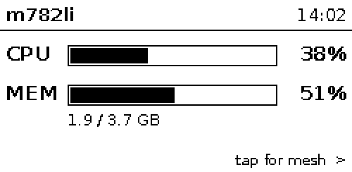
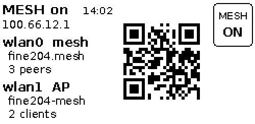
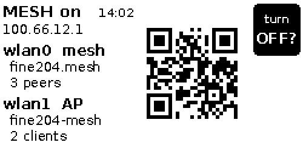
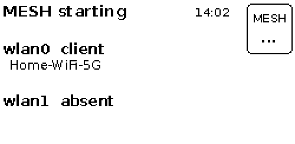
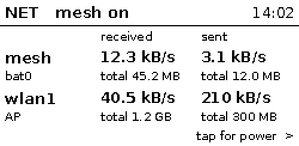
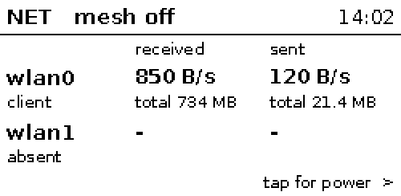
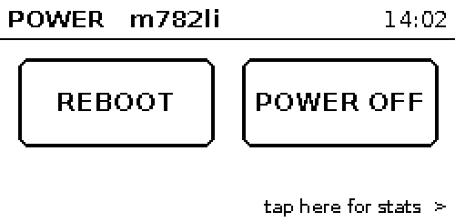
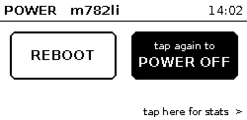
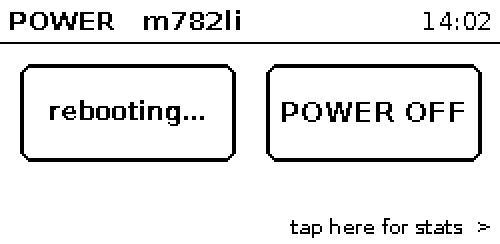
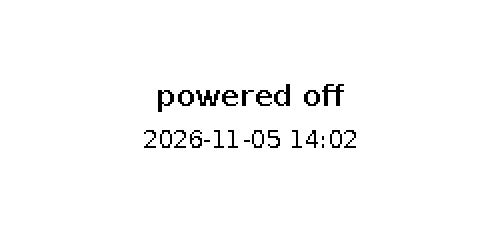

# rpi_mesh_epaper_stats

A status display for a [rpi_mesh_autodns](https://github.com/F1shcake-onegai/rpi_mesh_autodns)
node on the Waveshare 2.13" Touch e-Paper HAT (V4), with four screens:

- **STATS**: CPU and memory.
- **MESH**: the mesh, both radios, a QR code for joining the access point, and a button
  to turn the mesh on and off.
- **NET**: how much data the mesh and the radios receive and send.
- **POWER**: reboot and power off buttons.

It is also a worked example. The second half of this file, [Writing your own touch e-paper
app](#writing-your-own-touch-e-paper-app), explains how to build an app like this, step
by step, using this one as the reference.

New to the HAT? Start with [OFFICIAL_EXAMPLE.md](OFFICIAL_EXAMPLE.md). It takes Waveshare's
official example apart (init, refresh, structure, touch) and builds up to a first app of your
own, with small programs in [`examples/`](examples/).

| STATS | MESH (wlan1 runs the access point) |
|---|---|
|  |  |
| **MESH, button armed: tap again to switch** | **MESH, switching** |
|  |  |
| **NET, mesh on** | **NET, mesh off** |
|  |  |
| **POWER** | **POWER, power off armed: tap again to power off** |
|  |  |
| **POWER, rebooting** | **after a reboot or power off** |
|  |  |

## What it does

```
          tap anywhere            tap anywhere but the button          tap anywhere
  STATS ───────────────► MESH ───────────────────────────────► NET ───────────────► POWER
    ▲                     │  tap the button     → it asks "turn OFF?"                │
    │                     │  tap it again (5 s) → the mesh switches                  │
    │                                                                                │
    │                        tap REBOOT or POWER OFF → that one asks "tap again to"  │
    │                        tap it again (5 s)      → the Pi reboots / powers off   │
    └────────────────────── tap anywhere but the buttons ────────────────────────────┘
  Any screen: long press (hold 1 s) → hard refresh (white, then the screen).
  Every 30 s the screen is redrawn with fresh data, if anything changed.
```

- **STATS**: host name, time, CPU use (average over the last 30 s; "-" for the first
  30 s after start), memory used.
- **MESH**:
  - whether the mesh is on, and the node address
  - for wlan0 and wlan1: the job (mesh, AP, client, gateway, idle or absent), the SSID,
    and the number of peers or clients
  - when wlan1 runs the access point, a QR code that joins it (the AP is open for now)
  - the mesh button, top right
- **NET**: data received and sent, as a speed (average over the last 30 s; "-" for the
  first 30 s) and a total (since the interface came up):
  - while the mesh is on: **mesh** (`bat0`, the data this Pi exchanges with the mesh)
    and **wlan1**
  - while the mesh is off: **wlan0** and **wlan1**
  - `bat0` is created at every mesh start, so its totals count from then. The wlan0
    radio is not shown while the mesh is on: its counters would also include traffic
    this Pi relays for other Pis and batman-adv's own announcements.
- **POWER**: the host name, and two buttons side by side, **REBOOT** and **POWER OFF**.
  - The first tap on a button arms it: it turns black and says "tap again to". A second
    tap on the same button within 5 s reboots or powers off the Pi.
  - Only one button is armed at a time. With REBOOT armed, a tap on POWER OFF puts
    REBOOT back to normal and arms POWER OFF instead, and the other way round.
  - Once confirmed, the button shows "rebooting…" or "powering off…".
  - A tap anywhere else (the header, the footer) disarms and goes to STATS.
- **When the program stops**, it draws a last screen with the date and time. E-paper
  keeps its picture without power; without that screen, old numbers would look current.
  - **"powered off"** when the whole Pi is shutting down normally: a reboot or power
    off, from the POWER screen, a shell (`sudo reboot`, `sudo poweroff`) or anywhere else.
  - **"display stopped"** when only the program stops: Ctrl+C when you run it by hand,
    or `systemctl stop epaper-stats`.

## Install on the Pi

```bash
# 1. SPI and I2C on, then reboot
sudo raspi-config nonint do_spi 0
sudo raspi-config nonint do_i2c 0
sudo reboot

# 2. Packages (all from apt; nothing is cloned from git)
sudo apt install python3-gpiozero python3-lgpio python3-spidev python3-smbus \
                 python3-numpy python3-pil python3-qrcode fonts-dejavu-core

# 3. The program
sudo cp -r rpi_mesh_epaper_stats /opt/

# 4. Try it by hand and check the touch direction (Ctrl+C to stop)
cd /opt/rpi_mesh_epaper_stats
sudo python3 app.py --debug

# 5. Run it as a service
sudo cp epaper-stats.service /etc/systemd/system/
sudo systemctl daemon-reload
sudo systemctl enable --now epaper-stats
journalctl -u epaper-stats -f
```

In step 4, tap the four corners of the screen, holding the Pi so the text reads the right
way up. The log shows `tap at (x, y)` for each tap. Top left should be near (0, 0),
top right near (249, 0), bottom left near (0, 121) and bottom right near (249, 121). If
they are not, fix `to_landscape()` in `panel.py` before anything else.

Only one program can use the display's pins at a time. Stop the service
(`sudo systemctl stop epaper-stats`) before running `app.py` by hand.

It runs as root because starting and stopping `mesh.service`, `mesh-down.sh`, `batctl`,
reboot and power off need root, as `mesh-config` does.

## Files

| File | Job | Needs the HAT |
|---|---|---|
| `app.py` | state machine, main loop, start and stop; `--preview`, `--debug` | only to run for real |
| `screens.py` | draws every screen; layout, button touch area, QR code | no |
| `stats.py` | CPU and memory from `/proc` | no |
| `mesh.py` | mesh status (systemctl, iw, batctl, mesh-config's files); the on/off switch | no |
| `net.py` | bytes received and sent, from `/sys/class/net`; turns them into speeds | no |
| `power.py` | reboot and power off; tells a shutdown of the Pi from a stop of the program | no |
| `panel.py` | sends images to the panel, turns touch reports into gestures | yes |
| `TP_lib/` | Waveshare's drivers, copied (see the end of this file) | yes |
| `test_app.py` | tests that run on any computer | no |
| `OFFICIAL_EXAMPLE.md` | tutorial: Waveshare's official example, then a first app of your own | |
| `examples/` | the tutorial's four small programs | yes |
| `epaper-stats.service` | systemd unit | |

The app is built in layers. Only the bottom one touches hardware:

```
 app.py ─── state + main loop: decides WHAT happens and WHEN
   ├── screens.py   data   → image          no hardware: works on a laptop
   ├── stats.py     /proc  → numbers
   ├── mesh.py      systemctl, iw, batctl → MeshStatus; the switch runs in a thread
   ├── net.py       /sys/class/net → speeds and totals
   ├── power.py     systemctl reboot / poweroff in a thread; "is the Pi shutting down?"
   └── panel.py     image  → glass, glass → gestures    the only hardware code
          └── TP_lib     Waveshare: SPI, I2C, GPIO
```

## How it works

**The loop** (`App.run` in `app.py`). Every 10 ms it does at most one of these, in this
order:

1. A tap or long press: `handle_touch()` picks the next state and action, then the
   screen is redrawn.
2. A button was armed and 5 s passed without a second tap: disarm, redraw.
3. 30 s since the last update: close the CPU and network averaging window (whatever the
   screen), read fresh data, redraw.
4. The mesh is starting or stopping, or a reboot or power off is under way: check every
   3 s, redraw.

**Averages** (`App.sample` in `app.py`). CPU use and network speeds are averages over a
window between two readings of the kernel's counters. The window closes every 30 s on a
fixed clock, whatever screen is shown, and drawing a screen only shows the last closed
window. So STATS and NET always show the last 30 s, even right after you switch to them.
(Measuring from the last time the screen was drawn would show the average of all the time
you spent on other screens.)

**Refreshing** (`refresh_kind()` in `app.py`). Every redraw renders the screen first,
then picks the cheapest refresh that will do:

| Refresh | Looks like | When |
|---|---|---|
| none | | the new picture is the same as the one on the glass |
| partial | no flash, fast; leaves faint shadows ("ghosting") | the normal case |
| full | flashes, about 2 s; clears the shadows | at start-up, and after 20 partial refreshes |
| hard | full refresh to white, then a full refresh of the screen; about twice as long | long press |

At one update every 30 s, that is a full refresh about every 10 minutes. The clock on the
mesh screen changes once a minute, so an unchanged mesh screen refreshes at most once a
minute.

**Touch** (`Panel.poll` in `panel.py`):

1. The touch controller pulls its INT pin low when it has a new report.
2. The app reads the report over I2C and rotates the point into landscape coordinates.
3. A finger on the glass sends a stream of reports. The finger has lifted when the
   controller sends a lift report, or after 0.2 s without reports.
4. The stream becomes a gesture:
   - **tap**: the finger lifted within 1 s. It fires on the lift, so a long press is
     never also a tap.
   - **long press**: the finger stayed down for 1 s. It fires while the finger is still
     down, so you see the screen react; the lift afterwards is ignored.

Touches made while the panel is refreshing are dropped, and so is a finger still down
after a refresh: it has to lift first.

**The mesh switch** (`Toggler` in `mesh.py`):

- **On** runs `systemctl start mesh.service`.
- **Off** does what `mesh_off()` in mesh-config does: stop, `reset-failed`, and run
  `mesh-down.sh` directly if the unit was not active (for example after a failed start,
  when `systemctl stop` does nothing).
- Both run in a background thread, because starting can take up to two minutes. The
  button shows "..." meanwhile.
- The switch does not change whether the mesh starts at boot.
- Turning the mesh on takes wlan0 away from NetworkManager, so an SSH session over wlan0
  drops. The display keeps working; that is one reason to have it.

**Reboot and power off** (`PowerSwitch` and `system_stopping` in `power.py`):

- A confirmed button runs `systemctl reboot` or `systemctl poweroff` in a background
  thread. If that fails, the error is logged and the button goes back to normal.
- systemd then stops every service, this one included, with SIGTERM: the same signal as
  `systemctl stop epaper-stats`. To tell the two apart, the app asks
  `systemctl is-system-running` on its way out. It says `stopping` during any shutdown,
  however it was started, and the app draws "powered off"; otherwise "display stopped".
- Run by hand over SSH, the program also gets SIGHUP when the login session is stopped at
  shutdown, or when the SSH connection closes. It handles SIGHUP like SIGTERM, so it still
  draws its last screen. Under `nohup` it leaves SIGHUP ignored and keeps running.
- Only a normal shutdown can draw the last screen. If the power is cut, the glass keeps
  whatever it showed; the clock on every screen tells you how old that is.

---

## Writing your own touch e-paper app

This part is for anyone who wants to build their own app for this display. Each section
is one idea, with the place in this app where you can see it working.

### 1. Know what e-paper is good and bad at

- **It keeps its picture with no power.** Good for status displays. The catch: if your
  program crashes or stops, the last numbers stay on the glass and look current. Show the
  time on every screen and draw a "stopped" screen on exit (`render_stopped()`).
- **Refreshing is slow.** A full refresh takes about 2 s and flashes. A partial refresh
  is fast and calm, but after a few of them shadows of old pictures build up ("ghosting").
  Do a full refresh every so often.
- **Every refresh sends the whole screen.** "Partial" means the quick update without the
  flash, not a part of the screen.
- **The panel**: 250 × 122 pixels, about 0.19 mm per pixel, black and white only. No grey.

### 2. Draw a picture, then send it

Draw with Pillow into a 1-bit image, then hand the whole image to the driver:

```python
from PIL import Image, ImageDraw, ImageFont

image = Image.new("1", (250, 122), 255)      # mode "1": black and white; 255 = white
draw = ImageDraw.Draw(image)
font = ImageFont.truetype("/usr/share/fonts/truetype/dejavu/DejaVuSans.ttf", 14)
draw.text((4, 2), "hello", font=font, fill=0)  # 0 = black

epd.displayPartial_Wait(epd.getbuffer(image))  # getbuffer turns the image into panel bytes
```

Keep "make the picture" and "send the picture" apart. In this app every screen is a
function that takes data and returns an image (`render_stats`, `render_mesh`). Those
functions can run on a laptop and be saved as PNGs (section 9).

Text smaller than about 10 px is hard to read on this panel. Shorten long text rather than
letting it run off the edge (`fit()` in `screens.py`).

### 3. Get the coordinates right first

The panel is portrait (122 × 250) by nature. The touch controller reports portrait
coordinates too. This app draws in landscape (250 × 122), so every touch point has to be
rotated the same way the picture is:

```python
landscape_x = 249 - touch_y
landscape_y = touch_x
```

Check this before you build anything else: run with `--debug` and tap the four corners. If
the mapping is wrong, buttons seem to work "sometimes" or react to taps somewhere else,
and you will waste hours looking in the wrong place.

### 4. From touch reports to gestures

The touch controller does not send taps. It sends **reports**, many per second, for as
long as a finger is on the glass. You decide what a tap is.

- **Wait for the INT pin.** It goes low when a report is ready. Then read the report over
  I2C (`GT_Scan` in the Waveshare driver).
- **Never poll in a loop without sleeping.** Waveshare's demo does, and keeps one CPU core
  at 100 % forever. Poll every 10 ms instead. Let the GPIO library watch for the pin's
  edge, so a short pulse between two polls is not lost (`Panel.__init__`).
- **Track the touch from landing to lifting.** Remember when and where the finger landed.
  Treat it as lifted when the controller says so, or when reports stop for 0.2 s.
- **Decide on the lift, unless the gesture can't change any more.** If you have only taps,
  firing on landing feels fastest. Once there is also a long press, a tap must wait for
  the lift, otherwise every long press would start with a tap. The long press itself can
  fire as soon as the finger has been down for long enough (`Panel.poll`).
- **Ignore touches made during a refresh.** The user was aiming at a screen that is
  already changing. If the finger is still down afterwards, ignore it until it lifts.

Write the gesture code so you can test it with a fake clock and made-up reports. Timing
bugs are hard to see on the real glass.

### 5. Make touch areas bigger than what you draw

A fingertip is 8–10 mm wide: about 40–50 pixels on this panel. The "ON" on the button is
12 px tall. Nobody can hit that reliably.

- **Keep two rectangles**: what you draw (`BUTTON_BOX`) and what reacts to a finger
  (`BUTTON_HIT`). Make the second one larger.
- **Run touch areas to the edge of the screen.** A finger cannot overshoot an edge, so
  corners and edges are the easiest places to hit.
- **Don't let touch areas overlap.** If two can match one tap, which one wins is an
  accident of your code.
- **Make dangerous actions hard to trigger by accident.** Put them in a corner and ask for
  a second tap. Turning the mesh off disconnects everyone on the access point, so the
  button asks "turn OFF?" first. REBOOT and POWER OFF ask "tap again to" the same way.
- **Remember which button is armed, not only that one is.** With two dangerous buttons
  side by side, a first tap on REBOOT followed by a tap on POWER OFF must not power off.
  Here the app keeps the armed button's name (`App.armed`), and a tap on another button
  arms that one instead.

While you work on the layout, draw the touch areas in your previews to see them:
`draw.rectangle(BUTTON_HIT, outline=0)`.

### 6. Write the logic as a state machine

A **state** is which screen you are on (plus small things like "the button is armed"). A
**gesture** moves you from one state to another. Write that down as a table before you
code:

| State | Gesture | Next state | Also |
|---|---|---|---|
| any | long press, anywhere | same | hard refresh; disarm |
| STATS | tap anywhere | MESH | |
| MESH | tap the button | MESH | arm the button for 5 s |
| MESH | tap the button, armed | MESH | switch the mesh |
| MESH | tap the button, mesh starting or stopping | MESH | nothing |
| MESH | tap anywhere else | NET | disarm |
| NET | tap anywhere | POWER | |
| POWER | tap REBOOT or POWER OFF | POWER | arm that button for 5 s (and only that one) |
| POWER | tap the armed button | POWER | reboot or power off |
| POWER | tap a button, reboot or power off under way | POWER | nothing |
| POWER | tap anywhere else | STATS | disarm |

Then the table becomes one function, `handle_touch()` in `app.py`. It does no drawing and
no hardware, and does not read the clock. It takes the state and the gesture and returns
what should happen. Three jobs, three places:

- `handle_touch()` decides what happens.
- `render_...()` decides what it looks like.
- the main loop does everything that takes time or touches hardware.

Adding a screen means adding a state, a render function and some rows in
`handle_touch()`. Nothing else changes. NET was added exactly like that:

1. a state, `NET = 2`, and its place in the tap cycle, `NEXT = {STATS: MESH, MESH: NET, NET: STATS}`
2. a data module, `net.py`, that reads the numbers
3. a render function, `render_net()` in `screens.py`
4. one line in `App.render()` that connects the two

POWER followed the same steps (`POWER = 3`, `power.py`, `render_power()`), plus its
buttons in `button_at()`.

### 7. Decide when to refresh

Render first, then decide how to refresh. Here that decision is one small function,
`refresh_kind()`:

- **Nothing changed? Don't refresh.** Compare the new picture's bytes with the ones on
  the glass (`image.tobytes()`). This alone removes most refreshes: the 30-second update
  of an unchanged screen, the 3-second checks while the mesh switches.
- **Changed? Refresh partially.** It is fast and does not flash.
- **Refresh fully only when you must**: at start-up (the panel needs a picture to compare
  partial refreshes against), and after a number of partial refreshes, before the shadows
  become visible. This app allows 20. Waveshare's demo allows 50.
- **Let the user ask for a clean screen.** Here a long press does a hard refresh: white,
  then the screen.
- **Count your flashes.** A full refresh every 30 s would be 2,880 a day; this app does
  at most about 144 when nobody touches it.
- If your app refreshes rarely (every few minutes or less), **put the panel to sleep**
  between refreshes with `epd.sleep()`, and wake it with `epd.init(epd.FULL_UPDATE)`.
  Waveshare recommends not leaving it powered up while idle.

### 8. Never block the loop

While your code waits, nobody can tap. Anything that can take more than a moment (a
network request, `systemctl start`) goes into a background thread (`Toggler`):

1. Show at once that something is happening (the button shows "...").
2. Keep the loop running, and check now and then whether the work is done.
3. Draw the result when it is.

**Only the main loop draws.** If two threads talk to the panel at once, the SPI bytes mix
and the screen shows garbage.

### 9. Test without the hardware

- **Import the driver in one place only.** Importing `TP_lib` claims the GPIO pins
  immediately, and fails on a laptop. Here only `panel.py` imports it, and `app.py`
  imports `panel.py` only when it really runs. Everything else works anywhere.
- **Look at your screens as PNGs**: `python3 app.py --preview /tmp/screens`. This is
  much faster than waiting for refreshes on the real panel.
- **Test the logic**: `python3 test_app.py`. Because `handle_touch()` and
  `refresh_kind()` are plain functions, a test is one line:

  ```python
  assert app.handle_touch(app.MESH, "tap", 230, 20, None, False) == (app.MESH, "mesh", None)
  assert app.handle_touch(app.POWER, "tap", 190, 56, "reboot", False) == (app.POWER, "poweroff", None)
  assert app.refresh_kind(None, False, 20) == "full"
  ```

### 10. Run it as a service

- **Handle SIGTERM.** `systemctl stop` sends SIGTERM, not Ctrl+C, and so does a reboot or
  power off. Set a flag, let the loop finish its refresh, draw the last screen, then
  `epd.sleep()` and `epd.Dev_exit()`. See `main()` in `app.py`. To say "powered off"
  rather than "stopped", ask systemd whether the whole system is stopping
  (`system_stopping()` in `power.py`).
- **Log, don't print.** Use `logging` at INFO, so the journal holds what matters. Waveshare's
  touch driver printed every report; this copy logs them at DEBUG instead.
- **Set `WorkingDirectory=`.** gpiozero's lgpio backend creates `.lgd-nfy*` files in the
  current directory.
- **Set `Restart=on-failure`.** It covers crashes and boot races (SPI not ready yet).
- **Remember that only one program can own the pins.** Stop the service before running by
  hand.

### Common mistakes

| You see | Usually because |
|---|---|
| one CPU core at 100 % | a touch loop without a sleep |
| buttons work sometimes, or in the wrong place | touch points not rotated like the picture |
| one tap does two things | a resting finger counted as several taps |
| a long press also does what a tap does | the tap fired when the finger landed; fire it on the lift |
| grey shadows of old screens | only partial refreshes; add full ones |
| the screen flashes every few seconds | full refreshes on a timer, or refreshes when nothing changed |
| old numbers on the screen after a crash | no stopped screen, no time on the screen |
| an error that a GPIO pin is busy or in use | another copy (often the service) has the pins |
| an error opening `/dev/spidev0.0` or `/dev/i2c-1` | SPI or I2C not enabled |
| `systemctl stop` hangs, then kills the program | SIGTERM not handled |
| CPU or speeds look wrong right after switching to their screen | averaged since the screen was last drawn; sample on a fixed clock instead |
| a reboot leaves "display stopped" on the glass | the app cannot tell a shutdown from a stop; ask `systemctl is-system-running` |
| the journal fills with numbers | `print()` in a loop |

### Ideas to try

- Another screen with the CPU temperature (`/sys/class/thermal/thermal_zone0/temp`) and
  uptime. Follow the four steps at the end of section 6.
- A swipe (the finger moves more than 60 px before lifting) to switch screens. Track
  where the finger is in `Panel.poll`, not only where it landed.
- A list of mesh peers by name, from `/etc/hosts.mesh`.
- The clock updated every minute with a partial refresh, a full refresh only every
  10 minutes.

---

## Where TP_lib comes from

`TP_lib/` is copied from [waveshareteam/Touch_e-Paper_HAT](https://github.com/waveshareteam/Touch_e-Paper_HAT),
`python/lib/TP_lib` at commit `00b67c8`. Only `epd2in13_V4.py`, `gt1151.py`,
`epdconfig.py` and `__init__.py` are needed. All are unchanged except `gt1151.py`, where
two `print()` calls became `logging` calls, so the journal is not flooded with touch
reports. The pin numbers are in `epdconfig.py`.
